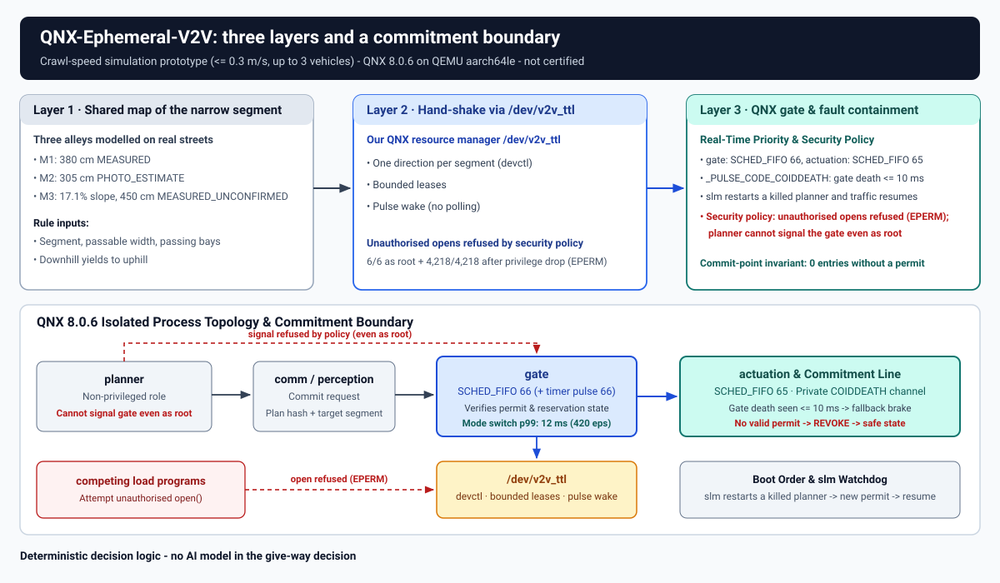

# QNX-Ephemeral-V2V: Deterministic Narrow-Lane Give-Way Logic on QNX 8.0.6

> **Crawl-speed simulation prototype (`<= 0.3 m/s`, up to 3 vehicles), not certified · all timings of our program on QNX 8.0.6 are QEMU TCG relative timings**

**Category:** Automotive & Mobility · **Bonus:** Best Use of QNX-Specific Technologies  
**Target & Toolchain:** QNX Neutrino RTOS 8.0.6 (`aarch64le` on QEMU TCG) · QNX SDP 8.0.6 (`qcc`, `mkqnximage`, `secpolcompile`), C & Rust (`staticlib` built with the Rust toolchain for QNX, linked by `qcc`)  
**Development Window:** Built & iterated Nov 3 – Nov 26, 2026 during the QNX Global Hackathon Submission Period (Nov 2 – Dec 15, 2026)

---

## The Problem

When two automated vehicles meet head-on in a single-car street without a shared give-way rule or a fail-closed commitment gate:

- **Urban geometry bottleneck:** **20.7%** of Taipei City's listed road length (`294,081 m` of `1,421,942 m`; `data.gov.tw 132587`, end of 2025, public record) is under `6 m` wide, leaving single-lane squeezes once curbs are occupied.
- **Emergency response interference:** San Francisco's rehearing filing (`CPUC A.23-09-015`, through `2023-08-07`, public record) cited **55 written reports** of driverless vehicles interfering with fire response (street type unstated in source).
- **Remote-assist opacity:** **0 of 7** autonomous-vehicle operators surveyed by a U.S. Senate oversight inquiry (`Sen. Edward J. Markey, "Remote Backseat Operators", 2026-03-31`) disclosed how often remote human operators intervene.

---

## Headline Measured Results (Our Prototype on Host & QNX 8.0.6)

| Result | What Our Prototype Measures & Which Binary Ran | Provenance (Tree · Date · Mode) |
|---|---|---|
| **32.05% → 0.061%** | Narrow-lane take-over requests at preregistered `50 cm` clearance across `594,000` simulated runs (`−31.99 pp`, 95% CI `29.55–34.40`; `1,782,000` runs across all three clearances) — host C simulator | `qnx_reg_20261118/effects_by_clr.txt` · host simulation · 2026-11-18 |
| **6/6 + 4,218/4,218 `EPERM` refusals · 0.35× fault-window gap** | Under our security policy on QNX 8.0.6, every attempt by competing load programs to open `/dev/v2v_ttl` was refused with `EPERM` (`6/6` as root, `4,218/4,218` after privilege drop), and during injected faults the largest gap in our hand-over measurements stayed at `0.35×` normal max (`15.120 ms` vs `43.465 ms`, limit `2×`; `n = 20,000` samples/condition) — C variant | `G23S` (`qnx_x_g23s_20261125`) · 2026-11-26 · `secpol` |
| **44–48 ms max actuation loop · 5–10 ms death detection · 30.0–36.0 → 11.9–12.0 ms `p99`** | Our C control matrix (`27` fault rows × `5` trials = `135` trials/boot; `2 nopol + 2 secpol` boots): actuation-loop max `45 / 47 ms` (`nopol`) and `48 / 44 ms` (`secpol`) against the `50 ms` limit; gate-death detection max `5–10 ms` (limit `100 ms`), onset-to-brake `6–10 ms`, onset-to-safe `304–306 ms`; `111` entries / `0` mismatches against a position oracle; decision-to-actuation `p99` under load reduced from `29,986–35,974 µs` to `11,882–12,010 µs` (`p99` only) — C variant | `J24A` / `AS1` (`qnx_x_a806_20261125`) · 2026-11-25 · `nopol` & `secpol` |
| **12 ms `p99` mode switchover (`420` episodes/boot)** | Admission-gate `HS <-> MAP` mode switchover across `420` episodes/boot (`1 nopol + 1 secpol` boot): `HS->MAP` `p99 12 ms / max 14 ms`, `MAP->RET` `p99 12 ms / max 20 ms` (budget `120 ms`); control `p99 14.0 ms` (`nopol`) / `13.0 ms` (`secpol`), `max 30.0 ms` — C variant | `J24C` (`qnx_x_bc806_20261125`) · 2026-11-25 · `nopol` & `secpol` |
| **0 mismatches across 5 on-target C-vs-Rust harnesses** | Our Rust-backed trust core (`staticlib` built with the Rust toolchain for QNX, linked by `qcc`) matched the C reference with `0` mismatches across `5` differential harnesses on QNX 8.0.6 (`100,000` stage-1 cases; `5,000` cases each for state, gateway, votes, and silent-member paths; `0` attack-table/scenario failures). Separately, our C trace program produced output hash `6D3B1D1EA40C1BA4` matching the host value-by-value over `9,753` lines once using QNX errno numbers — C + Rust target parity build | `SC806` (`qnx_x_sc806_20261125`) · 2026-11-25 · `nopol` |

### Per-Scene Simulation Breakdown (`50 cm` Preregistered Clearance)

| Scene | Take-Overs: Waiting Baseline → Give-Way Rule | Geometry Provenance (`b4m4_registry.tsv`) |
|---|---|---|
| `M1` red-line lane (`380 cm`) | **50.67% → 0.000%** | `380 cm MEASURED`; recess `ASSUMED` |
| `M2` blind-corner parking alley (`305 cm`) | **38.22% → 0.005%** | `305 cm` lane, `210 cm` bay, `590 cm` junction `PHOTO_ESTIMATE` |
| `M3` `17.1%` slope fence lane | **14.39% → 0.161%** *(host simulation results, `effects_by_clr.txt`, 2026-11-18)* | `17.1%` slope `MEASURED`; `450 cm` `MEASURED_UNCONFIRMED`; bay `ASSUMED` |


---

## QNX 8.0.6 Architecture & Native Mechanisms



We build bootable `aarch64le` images (`nopol` and `secpol`) with QNX SDP 8.0.6 (`qcc`, `mkqnximage`, `secpolcompile`) to isolate our application into microkernel roles:

- **Policy-confined reservation boundary (`secpol` + `/dev/v2v_ttl`):** Our custom QNX resource manager (`/dev/v2v_ttl`) enforces per-segment mutual exclusion and bounded leases via `devctl()`, `ionotify()`, `ConnectClientInfo()`, `ClockCycles()`, and `procmgr_ability()`. Under `secpol`, competing load programs are refused `open()` with `EPERM` (`6/6` as root, `4,218/4,218` after privilege drop; that run's base policy was learned on QNX 8.0.6), and the planner cannot signal the admission gate even as root.
- **Priority-isolated C control roles & `slm` supervision:** Our C control roles (`gate` and `act`) use native QNX message passing and pulses (`MsgSend`, `SIGEV_PULSE`) at `SCHED_FIFO 66/65` with `_PULSE_CODE_COIDDEATH` disconnect detection (negative control with death-watch off fails as required, `-1 ms`). Our boot-order and `slm` supervision suite verifies `gate` (`66`) → `act` (`65`, hold) launch ordering and deterministic `slm` permit-revoke, actuator-park, planner-restart, and traffic-resume recovery.
- **Additional QNX 8.0.6 probes & breadth:** In a single QNX 8.0.6 boot, `16` breadth-suite programs of our probe set passed (HAM and APS probes were skipped because those components are not in our image). On QNX 8.0.6, our probe programs measured CPU affinity (`runmask` `1.92×` / `1.85×`), `SCHED_SPORADIC` (`0.752` / `0.749` share vs `0.000` FIFO control), event-blocking wait (`0.48` / `0.61 ms` median vs `6.79` / `6.72 ms` polling), and Security-class kernel traces generated by our workload (`908,164` lines, `2,066` `SEC` events).

---

## Role of AI (and Why the Safety Gate Is Deterministic)

The commitment decision logic uses deterministic C control roles and a Rust-backed trust core—**never an AI model**—because a single wrong give-way decision risks a collision and every verdict must replay bit-identically (verified on QNX 8.0.6 by `0` mismatches across `5` C-vs-Rust target harnesses).

Around that deterministic safety core, AI drove the full engineering & verification lifecycle:
- **AI-Built Architecture & Rust Parity Port:** AI coding agents implemented the resource manager, differential test harnesses, and Rust trust-core port (`rust_port/`).
- **Multi-Round Adversarial AI Red-Teaming:** Three mutually blind stateless AI reviewers audited raw serial logs, mutation tests, and pass/fail criteria from tail to head across multiple hardening rounds, catching edge-case frame/vote/clock-wrap bugs and forcing transparent reporting of every measured miss.
- **AI-Assisted Scene Geometry & Visual Tooling:** Offline scene measurement scripts (`evidence/scene_measurement/`) and interactive HTML/SVG visualizers (`visualizer/`) communicate the protocol clearly without embedding third-party media.

---

## Quick Verification (Zero-Friction Judge Path)

1. **Interactive Visual Walkthrough (no build needed):** Open [`visualizer/before_after.html`](visualizer/before_after.html), [`visualizer/handshake_demo.html`](visualizer/handshake_demo.html), or [`visualizer/portal.html`](visualizer/portal.html) in any browser.
2. **Host C & SECMEM Verification (no QNX license required):**
```bash
make -C qnx_target test       # expected: ALL PASS (0 failed) & SECMEM ALL PASS (0 failed)
cd rust_port && cargo test    # expected: 16 passed; 0 failed
node visualizer/legal_gap_report.mjs   # expected: RESULT: PASS
```
   - **Python 3.10+ requirement:** `j24c/scripts/*.py` require Python 3.10 or newer (for example, `python3 -I j24c/scripts/j24c_gt_analyzer.py selftest` → `CHECK GT ALL PASS total_episodes=210`).
3. **Target QNX 8.0.6 Verification (requires QNX SDP 8.0.6 + license, QEMU `aarch64le`):**
   - See [`docs/QNX_EVIDENCE_TABLE.md`](docs/QNX_EVIDENCE_TABLE.md) for the exact QNX 8.0.6 capability-to-log matrix (`G23S`, `AS1`, `J24B`, `J24C`, `SC806`) and `qnx_run_all.sh` / `scripts/j24c_qnx_all.sh`. The full hash-chained boot ledger is retained locally and available on request.

---

## Scope, Measured Limits & Honest Disclosures

- **Scope & Timing Disclaimer:** This is a crawl-speed (`<= 0.3 m/s`, up to `3` vehicles) simulation prototype—not certified for road hardware or safety-critical deployment—and all timings of our program on QNX 8.0.6 are QEMU TCG relative timings, not real-time hardware bounds. Our simulation's sub-step back-fill can apply braking up to `(dt − 10) ms` earlier than the moment the controller learned of the failure (~`0.6 mm` at crawl speed), and no pass threshold was relaxed for any pre-registered test set.
- **Actuation-interval runs with a security policy (all QNX 8.0.6 runs):** Across four QNX 8.0.6 `secpol` full-matrix runs (`135` trials/boot, C variant), three met the `50 ms` actuation-interval criterion (`45`, `48`, and `44 ms`) and one missed it at `97 ms` (1 late wake-up in `1` of `135` trials while host load reached `4.6`). Both runs whose policy was learned directly on QNX 8.0.6 passed (`48` and `44 ms`).
- **Hand-over priority separation and tail:** Our hand-over probe (`n = 20,000` samples/condition, C variant) shows `p99` priority separation of `15.8×` in `nopol` (`784 µs` low-priority vs `12,406 µs` same-priority) and `8.9×` in `secpol` (`1,554 µs` low vs `13,802 µs` same). Under the original separation rule (`same-priority p99.9 > low-priority p99.9`), both QNX 8.0.6 runs pass (`30,864 > 30,543 µs` `nopol`; `30,648 > 20,412 µs` `secpol`); a separate copy of the checker with an inverted sign reports `FAIL`.
- **Pre-registered v1 budget premise (`FAIL`, reported as measured):** The v1 premise required stale-request tails `> 500 ms` TTL, which did not occur in any of our five QNX 8.0.6 boots (stale `p40` max `46.1–243.0 ms`). Flood maxima (`781.4–1,050.7 ms`) exceeded `500 ms` while `330.0–447.0 ms` TTL headroom held at `p99` only.
- **Test-only time divisor:** In our QNX 8.0.6 device-path reservation harness, the resource manager runs with `--resv-time-div 5` (`5×` scaled lease timers for emulated runs; default in production/code is `1`). With an earlier divisor of `50`, those scenarios passed `1/6`; moving to `5` together with harness fixes passes `6/6`.
- **Target SDK identity note:** Raw unmodified serial logs from target QEMU images preserve the kernel's `uname` string verbatim; QNX SDP 8.0.6 is confirmed by our SDK `procnto` hash prefix (`44f563a0`), the `LDQNX` boot-line marker in our image build file, and the `2026/10/30` build date.

See [`KNOWN_LIMITATIONS.md`](KNOWN_LIMITATIONS.md) and [`docs/QNX_EVIDENCE_TABLE.md`](docs/QNX_EVIDENCE_TABLE.md) for the full technical record.
