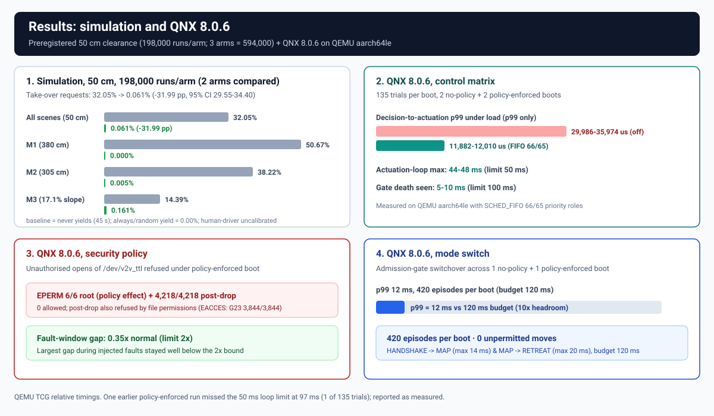

# QNX-Ephemeral-V2V: Deterministic Narrow-Lane Give-Way Logic on QNX 8.0.6

> **Crawl-speed simulation prototype (`<= 0.3 m/s`, up to 3 vehicles), not certified · all timings of our program on QNX 8.0.6 are QEMU TCG relative timings**

**Category:** Automotive & Mobility · **Bonus:** Best Use of QNX-Specific Technologies  
**Target & Toolchain:** QNX Neutrino RTOS 8.0.6 (`aarch64le` on QEMU TCG) · QNX SDP 8.0.6 (`qcc`, `mkqnximage`, `secpolcompile`), C & Rust (`staticlib` built with the Rust toolchain for QNX, linked by `qcc`)  
**Development Window:** Built & iterated Nov 3 – Nov 26, 2026 during the QNX Global Hackathon Submission Period (Nov 2 – Dec 15, 2026)

---

## The Problem

When two automated vehicles meet head-on in a single-car street without a shared give-way rule or a fail-closed commitment gate:

- **Urban geometry bottleneck:** **20.7%** of Taipei City's listed road length (`294,081 m` of `1,421,942 m`; `data.gov.tw 132587`, end of 2025, public record) is under `6 m` wide, leaving single-lane squeezes once curbs are occupied.
- **Emergency response interference:** San Francisco's rehearing filing (`CPUC A.23-09-015`, through `2023-08-07`, public record) cited **55 written reports** of driverless vehicles interfering with fire response (street type unstated in source).
- **Remote-assist opacity:** **0 of 7** autonomous-vehicle operators surveyed by a U.S. Senate oversight inquiry (`Sen. Edward J. Markey, "Remote Backseat Operators", 2026-03-31`) disclosed how often remote human operators intervene.

---

## Headline Measured Results (Our Prototype on Host & QNX 8.0.6)

| Result | What Our Prototype Measures & Which Binary Ran | Provenance (Tree · Date · Mode) |
|---|---|---|
| **32.05% → 0.061%** | Narrow-lane take-over requests at the preregistered `50 cm` clearance: our give-way rule (arm `A01`, `0.061%`) versus the waiting baseline (arm `A00`, `32.05%`: the car waits in place, never yields on its own, and requests a take-over after `45 s`, `j24c/qnx_target/src/v2v_spec2_sim.inc.c:4876`); `−31.99 pp`, 95% CI `29.55–34.40`; rule + borrow-cell map (`A11`) `0.077%`. `594,000` = three arms × `198,000` runs at `50 cm` (`qnx_reg_20261118/NOTES_594000.md`); `1,782,000` runs across all three clearances — host C simulator. Against a first car that always or randomly yields, take-overs are `0.00%` with or without our rule (see *Fairer Baselines*) | `qnx_reg_20261118/effects_by_clr.txt:4,19` · host simulation · 2026-11-18 |
| **6/6 + 4,218/4,218 `EPERM` refusals · 0.35× fault-window gap** | Under our security policy on QNX 8.0.6, every attempt by competing load programs to open `/dev/v2v_ttl` was refused with `EPERM` (`6/6` as root, the policy's own effect; `4,218/4,218` after privilege drop, where file permissions alone would also refuse: without the policy, boot `G23` refused `3,844/3,844` with `EACCES`, `g23_nopol_qnx_summary.txt:13,35`), and during injected faults the largest gap in our hand-over measurements stayed at `0.35×` normal max (`15.120 ms` vs `43.465 ms`, limit `2×`; `n = 20,000` samples/condition) — C variant | `G23S` (`qnx_x_g23s_806_20261125`) · 2026-11-26 · `secpol` |
| **44–48 ms max actuation loop · 5–10 ms death detection · 30.0–36.0 → 11.9–12.0 ms `p99`** | Our C control matrix (`27` fault rows × `5` trials = `135` trials/boot; `2 nopol + 2 secpol` boots `A1`, `A2`, `AS1`, `AS2`, a different set from the four `secpol` actuation-interval runs below): actuation-loop max `45 / 47 ms` (`nopol`) and `48 / 44 ms` (`secpol`) against the `50 ms` limit; gate-death detection max `5–10 ms` in these four boots (limit `100 ms`; `12 ms` in the separate `EV3H` run, `ev3h_qnx_secpol.serial.clean.log:912`), onset-to-brake `6–10 ms`, onset-to-safe `304–306 ms`; `111` entries / `0` mismatches against a position oracle; decision-to-actuation `p99` under load reduced from `29,986–35,974 µs` to `11,882–12,010 µs` (`p99` only) — C variant | `J24A` / `AS1` (`qnx_x_a806_20261125`) · 2026-11-25 · `nopol` & `secpol` · logs `a1_nopol_*`, `a2_nopol_*`, `as1_*`, `as2_*` (`:910-912`, timing `:928-935`) |
| **12 ms `p99` mode switchover (`420` episodes/boot)** | Admission-gate mode switchover, `HANDSHAKE → MAP` and `MAP → RETREAT`, across `420` episodes/boot (`1 nopol + 1 secpol` boot): `HANDSHAKE → MAP` `p99 12 ms / max 14 ms`, `MAP → RETREAT` `p99 12 ms / max 20 ms` (budget `120 ms`); control `p99 14.0 ms` (`nopol`) / `13.0 ms` (`secpol`), `max 30.0 ms` — C variant | `J24C` (`qnx_x_bc806_20261125`) · 2026-11-25 · `nopol` & `secpol` |
| **0 mismatches across 5 on-target C-vs-Rust harnesses** | Our Rust-backed trust core (`staticlib` built with the Rust toolchain for QNX, linked by `qcc`) matched the C reference with `0` differences across `5` differential harnesses on QNX 8.0.6 (`100,000` stage-1 cases; `5,000` cases each for state, gateway, votes, and silent-member paths; attack-table phase `failures=0`) (`evidence/qnx_806/logs/rc1_qnx_nopol.serial.clean.log:99-117,272`). Separately, our C trace program produced output hash `6D3B1D1EA40C1BA4` matching the host value-by-value over `9,753` lines once using QNX errno numbers (`evidence/qnx_806/logs/w2_qnx_probew2806.serial.clean.log:9776`; host side `evidence/qnx_806/w2_hostcheck/`) — C + Rust target parity build | `RC1` (`qnx_x_rc806_20261124`) · 2026-11-25 · `nopol`; trace `W2` · 2026-11-25 · `nopol` |

### Per-Scene Simulation Breakdown (`50 cm` Preregistered Clearance)

| Scene | Take-Overs: Waiting Baseline → Give-Way Rule | Geometry Provenance (`qnx_reg_20261118/b4m4_registry.tsv`) |
|---|---|---|
| `M1` red-line lane (`380 cm`) | **50.67% → 0.000%** | `380 cm MEASURED`; recess `ASSUMED` |
| `M2` blind-corner parking alley (`305 cm`) | **38.22% → 0.005%** | `305 cm` lane, `210 cm` bay, `590 cm` junction `PHOTO_ESTIMATE` |
| `M3` `17.1%` slope fence lane | **14.39% → 0.161%** *(host simulation results, `effects_by_clr.txt`, 2026-11-18)* | `17.1%` slope `MEASURED`; `450 cm` `MEASURED_UNCONFIRMED`; bay `ASSUMED` |



---

## QNX 8.0.6 Architecture & Native Mechanisms


We build bootable `aarch64le` images (`nopol` and `secpol`) with QNX SDP 8.0.6 (`qcc`, `mkqnximage`, `secpolcompile`) to isolate our application into microkernel roles:

- **Policy-confined reservation boundary (`secpol` + `/dev/v2v_ttl`):** Our custom QNX resource manager (`/dev/v2v_ttl`) enforces per-segment mutual exclusion and bounded leases via `devctl()`, `ionotify()`, `ConnectClientInfo()`, `ClockCycles()`, and `procmgr_ability()`. Under `secpol`, competing load programs are refused `open()` with `EPERM` (`6/6` as root; `4,218/4,218` after privilege drop, which file permissions alone would also refuse with `EACCES` without the policy; that run's base policy was learned on QNX 8.0.6), and the planner cannot signal the admission gate even as root.
- **Priority-isolated C control roles & `slm` supervision:** Our C control roles (`gate` and `act`) use native QNX message passing and pulses (`MsgSend`, `SIGEV_PULSE`) at `SCHED_FIFO 66/65` with `_PULSE_CODE_COIDDEATH` disconnect detection (negative control with death-watch off fails as required, `-1 ms`). Our boot-order and `slm` supervision suite verifies `gate` (`66`) → `act` (`65`, hold) launch ordering and deterministic `slm` permit-revoke, actuator-park, planner-restart, and traffic-resume recovery.
- **Additional QNX 8.0.6 probes & breadth:** In a single QNX 8.0.6 boot, `16` breadth-suite programs of our probe set passed (`[QNXRUN] ... rc=0` lines of `evidence/qnx_806/logs/f806_qnx_full.serial.clean.log`; HAM and APS probes were skipped because those components are not in our image, `:505-506`). On QNX 8.0.6, our probe programs (`probes/qnx_target/src/probe_ext.c`, `probe_ipc.c`) measured CPU affinity (`runmask` `1.92×` / `1.85×`), `SCHED_SPORADIC` (`0.752` / `0.749` share vs `0.000` FIFO control), event-blocking wait (`0.48` / `0.61 ms` median vs `6.79` / `6.72 ms` polling) (`probe806_run1` / `run2` logs, lines `28`, `31`, `37-38`), and Security-class kernel traces generated by our workload with `tracelogger` (`908,164` lines, `2,066` `SEC` events; `evidence/qnx_806/logs/e806_qnx_secpol.serial.clean.log:69`, commands `probes/scripts/e806_j24_cmds.txt:46-59`).

---

## Role of AI (and Why the Safety Gate Is Deterministic)

The commitment decision logic uses deterministic C control roles and a Rust-backed trust core—**never an AI model**—because a single wrong give-way decision risks a collision and every verdict must replay bit-identically (verified on QNX 8.0.6 by `0` mismatches across `5` C-vs-Rust target harnesses).

Around that deterministic safety core, AI drove the full engineering & verification lifecycle:
- **AI-Built Architecture & Rust Parity Port:** AI coding agents implemented the resource manager, differential test harnesses, and Rust trust-core port (`rust_port/`).
- **Multi-Round Adversarial AI Red-Teaming:** Memoryless AI reviewers audited raw serial logs, mutation tests, and pass/fail criteria from tail to head in several rounds: a first round of five independent reviewers (judge view, code defects, protocol logic, claims audit, release readiness) and a second round that added the quota, expired-slot reuse and summary-truncation checks (`KNOWN_LIMITATIONS.md:5,7`), catching edge-case frame/vote/clock-wrap bugs and forcing transparent reporting of every measured miss.
- **AI-Assisted Scene Geometry & Visual Tooling:** Offline scene measurement scripts (`evidence/scene_measurement/`) and interactive HTML/SVG visualizers (`visualizer/`) communicate the protocol clearly without embedding third-party media.

---

## Quick Verification (Zero-Friction Judge Path)

1. **Interactive Visual Walkthrough (no build needed):** Open [`visualizer/before_after.html`](visualizer/before_after.html), [`visualizer/handshake_demo.html`](visualizer/handshake_demo.html), or [`visualizer/portal.html`](visualizer/portal.html) in any browser.
2. **Host C & SECMEM Verification (no QNX license required):**
```bash
make -C qnx_target test       # expected: ALL PASS (0 failed) & SECMEM ALL PASS (0 failed)
cd rust_port && cargo test    # expected: 16 passed; 0 failed
node visualizer/legal_gap_report.mjs   # expected: RESULT: PASS
```
   - **Python 3.10+ requirement:** `j24c/scripts/*.py` require Python 3.10 or newer (for example, `python3 -I j24c/scripts/j24c_gt_analyzer.py selftest` → `CHECK GT ALL PASS total_episodes=210`).
   - **Re-grade the QNX 8.0.6 policy-enforced boot log on the host (no QNX needed):** `bash scripts/g23_qnx_check.sh evidence/qnx_806/logs/g23s_qnx_secpol.serial.clean.log secpol secure` → `PASS CHK-DENY secure: 6 loads; attempts as started 6 (refused EPERM 6, allowed 0), after the uid drop 4218 (refused EPERM 4218)` and `CHECK secpol ALL PASS`.
3. **Target QNX 8.0.6 Verification (requires QNX SDP 8.0.6 + license, QEMU `aarch64le`):**
   - See [`docs/QNX_EVIDENCE_TABLE.md`](docs/QNX_EVIDENCE_TABLE.md) for the exact QNX 8.0.6 capability-to-log matrix (`G23S`, `AS1`, `J24B`, `J24C`, `RC1`) and the recipes `g23/scripts/g23_qnx_all.sh`, `boot/scripts/j24b_qnx_all.sh`, `j24c/scripts/j24c_qnx_all.sh` (step by step: *Build and Boot on QNX 8.0.6* below). The full hash-chained boot ledger is retained locally and available on request.

---

## Scope, Measured Limits & Honest Disclosures

- **Scope & Timing Disclaimer:** This is a crawl-speed (`<= 0.3 m/s`, up to `3` vehicles) simulation prototype—not certified for road hardware or safety-critical deployment—and all timings of our program on QNX 8.0.6 are QEMU TCG relative timings, not real-time hardware bounds. Our simulation's sub-step back-fill can apply braking up to `(dt − 10) ms` earlier than the moment the controller learned of the failure (~`0.6 mm` at crawl speed), and no pass threshold was relaxed for any pre-registered test set.
- **Actuation-interval runs with a security policy (all QNX 8.0.6 runs):** Across four QNX 8.0.6 `secpol` full-matrix runs (`135` trials/boot, C variant), three met the `50 ms` actuation-interval criterion — `EV3H` `45 ms` (`evidence/qnx_806/logs/ev3h_qnx_secpol.serial.clean.log:911`), `AS1` `48 ms` (`as1_qnx_secpol.serial.clean.log:911`), `AS2` `44 ms` (`as2_qnx_secpol.serial.clean.log:911`) — and one, `EV3I`, missed it at `97 ms` (`1` of `135` trials over the limit, `ev3i_qnx_secpol.serial.clean.log:930`, while host load peaked at `4.58`, `ev3i_host_load.log`). Both runs whose policy was learned directly on QNX 8.0.6 passed (`AS1` `48` and `AS2` `44 ms`; rounds `learn secpol`, `as1_qnx_all.log:1`). The `nopol` runs `A1` / `A2` (`45` / `47 ms`, `a1_nopol_…:910`, `a2_nopol_…:910`) are separate.
- **Hand-over priority separation and tail:** Our hand-over probe (`n = 20,000` samples/condition, C variant) shows `p99` priority separation of `15.8×` in `nopol` (`784 µs` low-priority vs `12,406 µs` same-priority) and `8.9×` in `secpol` (`1,554 µs` low vs `13,802 µs` same). Under the original separation rule (`same-priority p99.9 > low-priority p99.9`), both QNX 8.0.6 runs pass (`30,864 > 30,543 µs` `nopol`; `30,648 > 20,412 µs` `secpol`); a separate copy of the checker with an inverted sign reports `FAIL`.
- **Pre-registered v1 budget premise (`FAIL`, reported as measured):** The v1 premise required stale-request tails `> 500 ms` TTL, which did not occur in any of our five QNX 8.0.6 boots (stale `p40` max `46.1–243.0 ms`). Flood maxima (`781.4–1,050.7 ms`) exceeded `500 ms` while `330.0–447.0 ms` TTL headroom held at `p99` only.
- **Test-only time divisor:** In our QNX 8.0.6 device-path reservation harness, the resource manager runs with `--resv-time-div 5` (`5×` scaled lease timers for emulated runs; default in production/code is `1`). With an earlier divisor of `50`, those scenarios passed `1/6`; moving to `5` together with harness fixes passes `6/6`.
- **Target SDK identity note:** Raw unmodified serial logs from target QEMU images preserve the kernel's `uname` string verbatim; QNX SDP 8.0.6 is confirmed by our SDK `procnto` hash prefix (`44f563a0`, `evidence/qnx_806/RUN_REGISTRY_806.tsv`), the `LDQNX` boot-line marker in our image build file (`boot/qemu_image/output/build/ifs.build:22`), and the `2026/10/30` build date.

See [`KNOWN_LIMITATIONS.md`](KNOWN_LIMITATIONS.md) and [`docs/QNX_EVIDENCE_TABLE.md`](docs/QNX_EVIDENCE_TABLE.md) for the full technical record.

---

## Related Standard

- **Coordination standards and enforcement:** SAE J3186 (first edition `2023-03`, [SAE Mobilus](https://saemobilus.sae.org/content/J3186_202303)) specifies an application protocol and message sets for connected vehicles to share and coordinate maneuvers over V2X. Our program addresses a complementary question: once a give-way outcome is agreed, a QNX 8.0.6 gate enforces it, and the planner cannot overrule it.

---

## Clearance Sweep: Design Conclusion (Host Simulation, 2026-11-18)

- **The rule needs passing space wider than the other car plus the clearance.** Across all scenes, our rule (`A01`) cuts take-overs from `32.895%` to `1.578%` at `70 cm` and from `33.312%` to `17.740%` at `100 cm` (waiting baseline `A00` first; `qnx_reg_20261118/effects_by_clr.txt:5-6`). Per scene (`effects_by_clr.txt:14-18`): `M2` gives `39.567% → 3.481%` at `70 cm` and does not improve at `100 cm` (`40.521% → 40.521%`), while `M3` stays at `0.161%` with the rule at `70` and `100 cm`.
- **Why `M2` stops improving at `100 cm` (geometry table, no simulation):** at `100 cm` the other car needs `310 cm` of free width; in `M2` the space at the top end leaves `286 cm`, enough for the `260 cm` needed at `50 cm` but not for `310 cm` (`qnx_reg_20261118/strata_new/strata.csv:66,74`), and the in-alley stop box leaves `237.9 cm` (`:71`), so only the junction remains usable, which is not a passing bay (`qnx_reg_20261118/REGISTRY_NOTES.md:9`).
- **Design conclusion:** we keep `50 cm` as the clearance (the half-metre meeting gap cited in `g23/qnx_target/src/v2v_ttl_resmgr.c:205`) and treat a larger clearance as a map question: a narrow street only benefits if its map holds a passing space at least as wide as the other car plus the clearance.

## Potential Impact at Crawl Speed

At the `0.3 m/s` crawl speed, the gate-death path of our program brakes within `10 ms` of the fault (onset→brake max, `evidence/qnx_806/logs/as1_qnx_secpol.serial.clean.log:912`), about `3 mm` of travel, versus `477 ms` on the permit-expiry path with the death watch off (same line), about `14.3 cm` (distance = `0.3 m/s` × time; QEMU TCG relative timings).

## Fairer Baselines (Earlier Host-Simulator Tree, 2026-11-17; no QNX boot)

- **Waiting car given our map:** in the earlier `B4M2` ablation (`evidence/fair_baseline_20261117/spec2_b4abl.csv`, block `AB`, `1,080` settings × `200` trials per arm and clearance), the waiting car with our borrow-cell map (`A10`) had exactly the take-over rate of the waiting car without it (`31.096%` at `50 cm`, also equal at `70` and `100 cm`), against `0.107%` for our rule.
- **Cars that yield by habit:** in the earlier car-meets-car policy block `P` (`evidence/fair_baseline_20261117/spec2_j22b.csv`, `432` settings × `200` trials at `50` / `100 cm`), a first car that always yields (`J2B_ALWAYS`) or yields at random (`J2B_RANDOM`) had `0.00%` take-overs, the same as our rule; take-overs appeared only when the first car never yields (`59.42%` against a car that never yields, `23.92–24.25%` otherwise). Our `32.05% → 0.061%` headline is therefore measured against a baseline car that never yields on its own; where the first car always or randomly yields, the protocol's contribution is one shared, gate-enforced answer to who yields — a design goal, not a measured gain. In the same block, two cars that both never yield hit the `45 s` deadlock in `684` of `2,400` trials, while two cars that both use any yielding policy (always, random or our rule) had `0` (columns `deadlocks45`, `finished`). Method, hashes and the two `awk` lines: `evidence/fair_baseline_20261117/NOTES.md`.

## Build and Boot on QNX 8.0.6 (QEMU `aarch64le`)

These are the steps of the recipe that produced the policy-enforced `G23S` boot (`g23/` holds that tree's sources, policy files and scripts). We did not re-run them for this version of the repository.

**Not shipped:** QNX SDP 8.0.6, the QNX licence directory, the `linux/amd64` Docker image we used for `qcc` / `mkqnximage` / `secpolcompile`, the generated image (`ifs.bin`, disk images), and the SDK-generated `system.build` and `mkqnximage` option files. You need your own SDP 8.0.6 and licence, Docker, `qemu-system-aarch64` and `python3`.

1. **Compile:** `bash g23/scripts/g23_compile.sh secpol` cross-compiles the `4` programs with `qcc` inside the container into `g23/qnx_target/build_g23/secpol/` (environment `QNX_SDP_DIR`, `QNX_USER_DIR`, `QNX_SDP_MOUNT_OPTS=':ro'`; our log: `g23/evidence/g23/qnx_secpol.compile.log`).
2. **Policy:** the recipe merges `g23/qnx_target/secpol/g23_base_g17f_combined.txt` with `g23_addendum.txt` (`g23/scripts/g23_secpol_tool.py --merge`, lint) and compiles the result with `secpolcompile` before any image is built (our merged policy: `g23/evidence/g23/qnx_secpol.policy.txt`).
3. **Image:** `g23/build_qnx_image.sh` runs `mkqnximage --type=qemu --arch=aarch64le --aarch64-version=8.2 --build --force` in the container (`g23/build_qnx_image.sh:186-187`) with the boot commands `g23/scripts/g23_cmds.txt`; the recipe first needs one `mkqnximage` run so that `g23/qemu_image/local/options` exists (`g23/scripts/g23_qnx_all.sh:77`). The image build file of our `J24B` image (`boot/qemu_image/output/build/ifs.build`, `LDQNX` at line `22`) and its `slm` configurations (`boot/evidence/j24b/qnx/j24b_slm_*.xml`, generated by `boot/scripts/j24b_slm_gen.py`) are published as examples.
4. **QEMU boot:** `bash g23/scripts/g23_run_qemu.sh secpol` boots the image under TCG (`-cpu cortex-a76 -smp 2 -m 1024`, `g23/scripts/g23_run_qemu.sh:28`) and stops at `V2V MINI END`.
5. **Host check:** `bash scripts/g23_qnx_check.sh evidence/qnx_806/logs/g23s_qnx_secpol.serial.clean.log secpol secure` (the published log; for your own boot, pass your serial log).

All in one, as we ran it: `cd g23 && QNX_SDP_DIR=<your SDP 8.0.6> QNX_USER_DIR=<your licence dir> QNX_SDP_MOUNT_OPTS=':ro' V2V_MKIMG_IMAGE=<your image> bash scripts/g23_qnx_all.sh` (steps 1–5 for `nopol` and `secpol`; exit `0` only if both boots pass; summary `g23/evidence/g23/qnx_summary.txt`). A number-to-file index for the submission text is in [`docs/CLAIMS_INDEX.md`](docs/CLAIMS_INDEX.md); every redacted file is listed in [`docs/REDACTIONS.md`](docs/REDACTIONS.md).

## How It Feels to Use (Prototype UI in Our Visualizer)

What follows is the prototype UI in `visualizer/handshake_demo.html` (an animation script, not a product screen) and our QNX 8.0.6 log.

1. **In the car:** the occupant's car first stops and waits (`stopped: waiting for the plan`, then `stopped: collecting votes`, `handshake_demo.html:1128,1131`), then shows its own step of the agreed route (`agreed: about to back off`, `step 1: backing off 7 m`, `agreed: waits for …`, `:1134,1139`) with hazards while it holds and the turn signal or white reverse lamps when it moves (`:1069`); the street ends with `Session closed: street clear, route R-4F39 done` (`:889`).
2. **For a remote-assist operator:** the *Operator view* table lists, per car, certificate, last frame, own plan hash, votes received and what it is doing now (`handshake_demo.html:56-59`; it follows the animation clock and there is no real fleet backend). If the votes do not match, every car shows `HOLD: retry next round (300 ms)` (`:1132`).
3. **On a fault (QNX 8.0.6 log):** when the planner is killed (`evidence/qnx_806/logs/j24b_qnx_secpol.serial.clean.log:26`), the gate revokes the permit (`:56`), the actuation accepts the revoke, falls back and stops (`:367,369,379`), `slm` starts a new planner (`:951`), a new permit is issued (`:58`) and the car resumes (`:612`).
